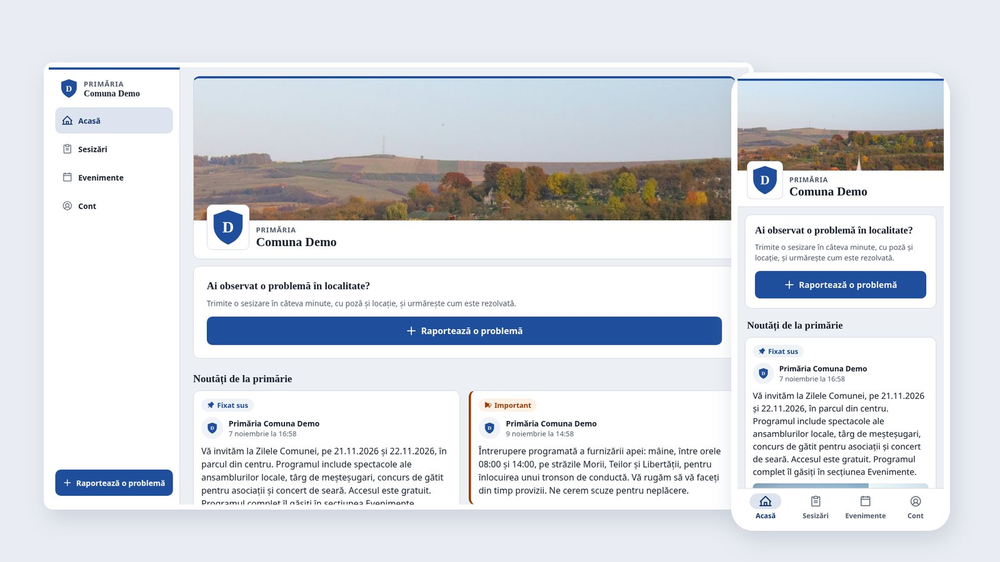
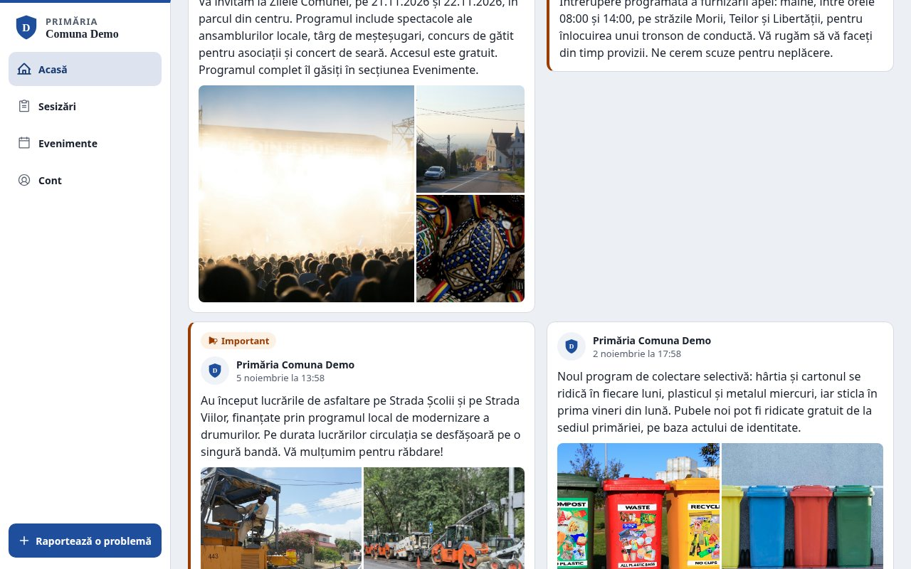
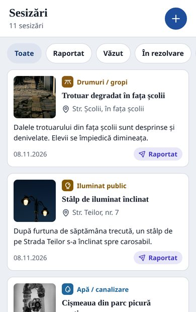
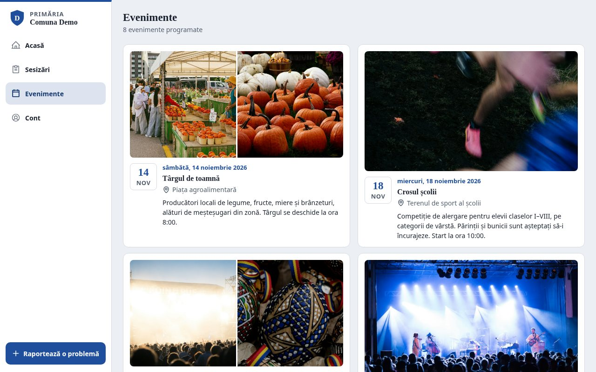
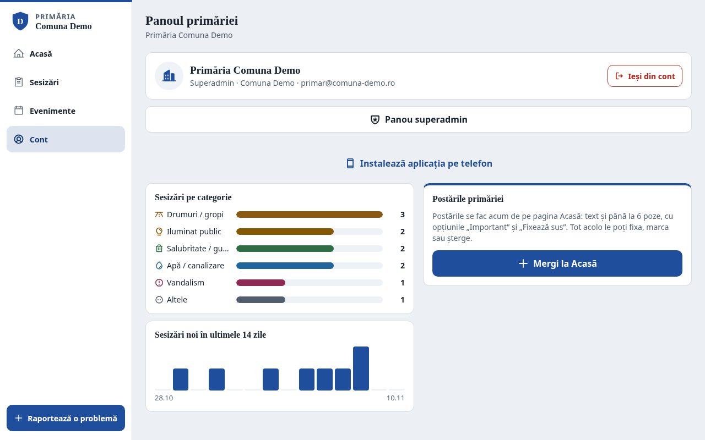
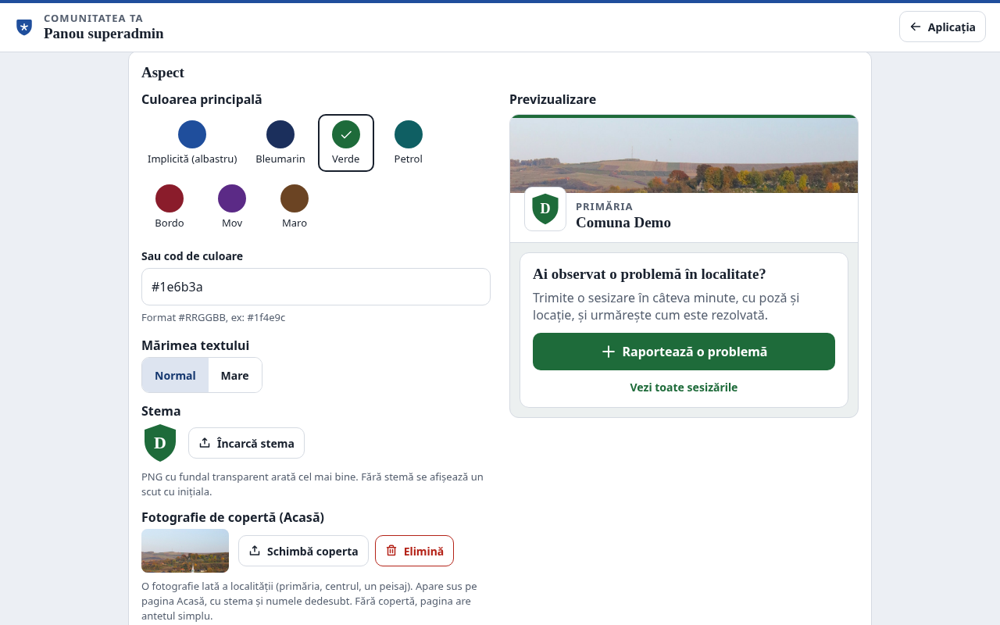
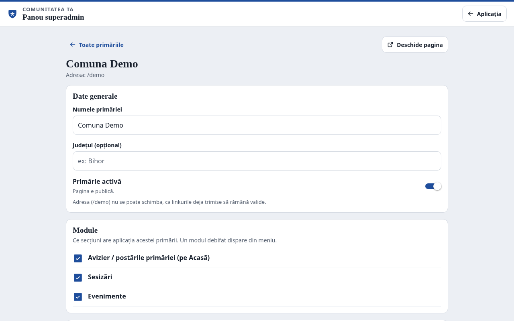
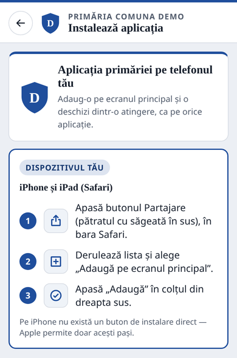

# Comunitatea ta

**A civic app for Romanian town halls: residents report problems with a photo and GPS location, the town hall moderates and resolves them, and publishes news, photo posts and events. One instance serves many town halls, each with its own address, colours, crest and modules.**

Started July 2026 · TypeScript, Expo / React Native + react-native-web, Supabase (Postgres, Row Level Security, Auth, Storage), Vercel · **source is private, see [Contact](#contact)**

> **Status (November 2026):** working demo with realistic sample content at **[comuna-app-gamma.vercel.app/demo](https://comuna-app-gamma.vercel.app/demo)**, installable as an app on Android and iPhone. Being prepared for a first town hall.

<p align="center">
  
</p>

A resident sees a pothole, a broken street light or an illegal dump, opens the app, takes a photo and sends it. The report waits for the town hall to approve it, then everyone can follow it from "reported" to "resolved". The same app is the town hall's notice board: posts with photos, important announcements pinned on top, and upcoming events. Each town hall gets its own page (`/tinca`, `/demo`, …) and can switch whole sections on or off.

## What it does today

- **Reports with photo and location**: six categories (roads, street lighting, waste, water, vandalism, other), GPS from the phone, an optional photo compressed on the device before upload, and a tracking code.
- **Moderation first**: a new report is invisible to the public until a town hall admin approves it. Rejected reports stay visible only to their author, with the reason.
- **An admin dashboard that is used**: status changes, search and filters, an internal note per report, a map link from the GPS position, charts by category and over the last 14 days.
- **Notice board and events**: posts with up to 6 photos, "important" and "pinned" markers, editable text; events with date, place and photos.
- **One app, many town halls**: a superadmin panel to add a town hall, choose its colour, text size, crest and cover photo with a live preview, switch modules on or off, and manage its admins.
- **Installs like an app, without app stores**: a Progressive Web App with an install page that shows the right steps for each phone. The installed app opens on the town hall it was installed from and updates itself after every release.

## A short tour

| | |
|---|---|
|  | **The town hall's notice board.** Posts with photos, an "Important" marker for service interruptions and a pinned post on top. |
|  | **Reports, as residents see them.** Photo, category, place and current status; only approved reports are public. |
|  | **Upcoming events.** Fairs, the commune's days, a public budget debate, each with place, date and photos. |
|  | **The town hall's dashboard.** What people report, by category and over time. |
|  | **Each town hall looks like itself.** Colour, text size, crest and cover photo, previewed before saving. |
|  | **Modules per town hall.** A town hall that does not want events simply does not have the tab. |
|  | **Installing without an app store.** The page detects the phone and shows only the steps that apply to it. |

## How it works

```text
Resident / town hall staff
   │   browser or installed app (PWA)
   ▼
One Expo / React Native codebase, exported as a static web app on Vercel
   │   /<town-hall>/...   →  the town hall is loaded from the address
   │   public key + the user's session; no API server of our own
   ▼
Supabase
   ├── Auth        Google for residents, email + password for town hall staff
   ├── Postgres    every access rule is a Row Level Security policy
   └── Storage     report photos, post and event photos, crests, covers

Superadmin  ──►  /superadmin  ──►  per-town-hall settings (modules, theme, branding)
Vercel function  ──►  per-town-hall install manifest (name, colour, start page)
```

- The app talks to the database directly. What a visitor, a resident, an admin or the superadmin may read or change is decided by the database, so it cannot be bypassed by editing the app.
- A town hall's look and sections are data, not separate copies of the code: a fix or a new feature reaches every town hall at once.

## Security model

- **Rules live in the database.** Row Level Security covers every table, including who may upload or delete which photos.
- **Moderation is enforced by the database**, not only by the app. A report can only be created as "awaiting approval".
- **Residents' contact details are kept apart.** Name, phone number and internal notes are in a separate table that only the admins of that town hall can read. The public list of reports never includes them.
- **Admins are limited to their own town hall.** A town hall admin cannot see or change another town hall's data. Only the superadmin works across town halls.
- **Tested by role.** The policies were checked against a local Postgres for each role (visitor, resident, an admin of another town hall, admin, superadmin) before going live. Schema changes ship as small, re-runnable migrations.

## Designed for a town hall

- **Readable first**: 16 px base text with a "large text" option per town hall, WCAG AA contrast and 48 px touch targets. Many users are older residents.
- **Looks official, not like a startup**: a white header with the town hall's crest, serif headings, and the town hall's own colour. Colours that are too light are darkened automatically to keep contrast.
- **Works on any screen**: a bottom tab bar on phones and a sidebar on desktop, from the same code.

## Pe scurt (RO)

**Comunitatea ta** este aplicația primăriei pentru telefon și calculator:

- **Sesizări:** cetățenii raportează probleme din comună (gropi, iluminat, gunoi, apă), cu poză și locație.
- **Moderare:** primăria le aprobă, le rezolvă și arată fiecăruia stadiul.
- **Avizier și evenimente:** primăria publică anunțuri, postări cu poze și evenimente.
- **Instalare simplă:** se instalează direct din browser, fără magazin de aplicații, și se actualizează singură.
- **Aspectul primăriei:** fiecare primărie are propria adresă, stemă și culori și alege ce secțiuni folosește.

Demo: **[comuna-app-gamma.vercel.app/demo](https://comuna-app-gamma.vercel.app/demo)**. Pentru o prezentare, scrieți-mi la adresa de mai jos.

## What it does not do (yet)

- **Push notifications:** paused until a town hall confirms it wants them.
- **Map:** there is no map view of all active reports yet.
- **Status timeline for residents:** a resident sees the current status of a report, but not yet its full history.
- **Privacy policy page and accessibility statement:** in progress. Both are needed before a real launch.
- **Town hall registry (registratură):** no integration with it. Every town hall uses a different system.

## Where it's going

- **Public answers on resolved reports:** a short reply from the town hall and an "after" photo, so "resolved" comes with proof.
- **The 30-day legal deadline for petitions,** visible to admins, with reports close to it highlighted.
- **A map of reports,** with a warning when the same problem has already been reported nearby.
- **A public transparency page:** how many reports were resolved, how fast, by category.

## Contact

The source code is private. If you'd like a walkthrough, a live demo for your town hall, or a code review, please get in touch: **hodisflorin01@gmail.com**.

&copy; 2026 Hodis Florin-Marian. All rights reserved.
